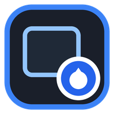
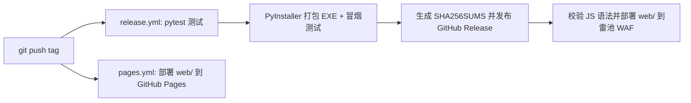

<div align="center">



# BatchWatermark

**双模式批量图片与视频水印工具 — 工作模式高效批处理 · 创作模式艺术化排版 · 所见即所得**

[](https://github.com/drank5090/BatchWatermark/releases)
[](https://github.com/drank5090/BatchWatermark/releases)
[](https://github.com/drank5090/BatchWatermark/stargazers)
[](https://github.com/drank5090/BatchWatermark/network/members)
[](LICENSE)

[](https://www.python.org/)
[](https://docs.astral.sh/uv/)
[-41CD52?logo=qt&logoColor=white)](https://doc.qt.io/qtforpython-6/)
[](https://python-pillow.org/)
[](https://ffmpeg.org/)
[](#多语言支持)

**[🌐 在线使用](https://watermark.zak-cloud.top/)** ·
**[⬇️ 下载 Windows 版](https://github.com/drank5090/BatchWatermark/releases/latest)** ·
**[🚀 快速开始](#快速开始)** ·
**[❓ 常见问题](#常见问题faq)** ·
**[🐛 反馈问题](https://github.com/drank5090/BatchWatermark/issues)**

</div>

> [!TIP]
> **不想安装？直接打开网页版即可使用**：[watermark.zak-cloud.top](https://watermark.zak-cloud.top/)（镜像：[GitHub Pages](https://drank5090.github.io/BatchWatermark/)）。
> 所有图片与视频均在浏览器本地内存中处理，**零上传、零服务器**，隐私绝对安全。

---

## 目录

- [项目简介](#项目简介)
- [界面预览](#界面预览)
- [三种使用方式](#三种使用方式)
- [工作模式：高效批量水印](#工作模式高效批量水印)
- [创作模式：艺术化智能排版](#创作模式艺术化智能排版)
- [多语言支持](#多语言支持)
- [网页版 vs 桌面端](#网页版-vs-桌面端)
- [快速开始](#快速开始)
- [开发、测试与打包](#开发测试与打包)
- [数据格式说明](#数据格式说明)
- [项目结构](#项目结构)
- [常见问题（FAQ）](#常见问题faq)
- [参与贡献](#参与贡献)
- [Star History](#star-history)
- [开源协议](#开源协议)

---

## 项目简介

**BatchWatermark** 是一款基于 **Python + PySide6 + Pillow + FFmpeg** 构建的开源水印工具，同时提供**桌面端**与**纯浏览器网页版**，两端共享同一套参数模型与 JSON 格式。

从 v2.0 起，软件分为两种互补的工作方式，可在顶部标签栏一键切换：

| | 🛠️ 工作模式 | ✨ 创作模式 |
| :--- | :--- | :--- |
| **适合人群** | 摄影师、电商、自媒体、短视频运营 | 插画师、画师、ACG 创作者、设计师 |
| **核心目标** | 快速、统一、批量地给大量图片/视频加水印 | 让水印成为画面的一部分，美观又防盗 |
| **支持媒体** | 图片 + 视频 | 图片 |
| **排布方式** | 全图平铺 / 九宫格单点定位 | 智能避让主体的多尺度艺术排版 + 自由拖拽 |
| **参数复用** | JSON 预设（本机持久化 + 导入导出） | 图文水印素材库（本机持久化 + 导入导出） |

无论哪种模式，**预览渲染与全分辨率导出均共用同一套渲染引擎与比例换算**，所见即所得。

---

## 界面预览

<table>
  <tr>
    <td align="center"><b>多图实时同步预览（斜向平铺水印）</b></td>
  </tr>
  <tr>
    <td></td>
  </tr>
  <tr>
    <td align="center"><b>横竖隔离 + 独立水印参数 + 视频实时预览 + 自定义预设</b></td>
  </tr>
  <tr>
    <td></td>
  </tr>
</table>

---

## 三种使用方式

| 方式 | 适用场景 | 入口 |
| :--- | :--- | :--- |
| 🌐 **在线网页版** | 临时使用、手机/平板、不想安装任何东西 | [watermark.zak-cloud.top](https://watermark.zak-cloud.top/) |
| 🪟 **Windows 独立 EXE** | 日常高频使用、处理大批量视频 | [Releases 下载](https://github.com/drank5090/BatchWatermark/releases/latest)，双击即用（已内置 Python、Qt 与 FFmpeg） |
| 🐍 **源码运行** | macOS / Linux 用户、二次开发 | `uv sync && uv run batch-watermark`（详见[快速开始](#快速开始)） |

---

## 工作模式：高效批量水印

### 1. 多图 / 视频 / 文件夹批量导入与实时同步预览

- **灵活导入**：多选文件、导入整个文件夹（可选递归子目录）、直接拖拽文件或文件夹到预览区，自动按路径去重。
- **格式广泛**：
  - **图片**：`JPG` / `JPEG` / `PNG` / `WebP` / `BMP` / `TIFF`，自动按 EXIF Orientation 矫正竖拍照片。
  - **视频**：`MP4` / `MOV` / `MKV` / `AVI` / `WebM` / `M4V` / `WMV` / `FLV`，自动提取真实展示方向的代表帧并标注 `▶ 时长` 徽章。
- **流畅的多线程实时渲染**：采用 **40ms 防抖 + 分代渲染令牌 + 多线程池 + 视口优先调度**，优先刷新屏幕可见卡片，拖动滑块丝滑不卡顿；支持自由调节卡片尺寸、单张移除与一键清空。
- **高清大图与视频时间轴预览**：双击卡片或点击 `🔍` 打开高清预览窗；视频支持拖动时间轴或快捷跳转（`开头` / `25%` / `50%` / `75%`）检查任意时刻的水印效果。

### 2. 横版 / 竖版隔离模式

- **分开展示**：开启后预览区自动拆分为 **「横版媒体区（宽 ≥ 高）」** 与 **「竖版媒体区（高 > 宽）」**，支持 `分组并列显示` / `仅看横版` / `仅看竖版` 筛选，角标实时显示 `横 N / 竖 M`。
- **可选独立水印参数**：默认横竖共用一套参数；勾选 **「横版与竖版使用独立水印参数」** 后可分别定制（如 16:9 横屏视频与 9:16 竖屏短视频使用不同字号与位置），并支持一键同步到另一方向。
- **分文件夹导出**：导出时自动在输出目录下创建 **`横版/`** 与 **`竖版/`** 子文件夹分类存放。

### 3. 自定义预设管理

- **内置模板**：「全图斜向平铺 (防盗)」「右下角精致签名」「正中心醒目样图」「底部居中版权栏」。
- **本机持久保存**：点击 **「保存预设」** 即持久化至本机配置目录，重启自动加载，支持覆盖与删除。
- **便携 JSON 导入导出**：可导出当前参数或全部自定义预设，导入时重名自动编号；**桌面端与网页版预设完全互通**。

### 4. 丰富的水印样式

- **文字水印**：多行文本，自动扫描系统中英文字体（微软雅黑、黑体、宋体、楷体、等线、Segoe UI、Arial 等）并支持导入本地 `.ttf / .otf / .ttc`；颜色拾取、常用色板、描边、投影、行间距。
- **图片 / Logo 水印**：支持带 Alpha 通道的 PNG / WebP Logo，按目标媒体宽度百分比自适应缩放。
- **两种排布模式**：
  - **全图平铺**：自定义水平/垂直间距、任意旋转角度、奇偶行砖墙交错（基于旋转基向量定位，无四角裁切伪影）。
  - **单点定位**：3×3 九宫格定位器 + 边距百分比 + X/Y 精细微调。
- **按媒体尺寸自适应比例**：不同分辨率混合批处理时保持统一的视觉大小。

### 5. 高保真批量导出

- 自定义输出目录、文件名前缀/后缀（默认后缀 `_watermarked` 保护原图）、重名自动编号或覆盖。
- **图片**：保持原格式 / JPEG / PNG / WebP，可调压缩质量（50%–100%），可保留 EXIF（Orientation 自动规范化为 `1`，避免二次旋转）。
- **视频**：Pillow 生成全分辨率透明水印图层，经 FFmpeg 单次 `overlay` 合成，输出高兼容性 H.264 `MP4`（`yuv420p` + `faststart`），默认保留原声（AAC 192k，可选静音），支持实时进度与随时取消。

---

## 创作模式：艺术化智能排版

> 灵感来自插画 / ACG 画师常用的“艺术水印”：大小不一的雪花、星光、印章与诗意文字错落点缀画面，既好看又难以被整体抠除。

### 1. 图文水印素材库

- **开箱即用的艺术素材包**：内置 `❄️ 晶莹雪花`、`❅ 冰晶星芒`、`✧ 梦幻星光`、`💮 初雪印章`、`〰 丝带波纹` 等图形元素，以及主标题、诗意双语落款、微防盗签等文字元素。
- **自由扩充**：`＋ 上传图片水印`（PNG / WebP 透明素材）或 `＋ 文字水印`（字体、颜色、描边、柔和外发光）。
- **精细控制**：每个素材可设置角色（`自动` / `主标题 Hero` / `点缀 Accent` / `微型 Micro`）、出现权重、基准尺寸、不透明度与随机倾斜范围，勾选即参与自动排版。
- **持久化与分享**：素材库自动保存到本机，支持 `导出库` / `导入库`（自包含 Base64 图片，跨设备、跨桌面/网页端通用），可随时 `恢复默认`。

### 2. 智能美观排版引擎

- **主体避让**：基于 48×48 视觉显著性图 + 人像中心保护区，大尺寸水印自动避开人脸与画面主体，优先落在边缘与留白区域。
- **多尺度层级**：主标题（Hero）→ 大小错落的点缀（Accent）→ 低透明度微型防盗底纹（Micro），形成有节奏的视觉层次。
- **防堆叠**：加权 Best-Candidate / 蓝噪声碰撞规避，元素分布自然不扎堆。
- **四种风格**：

  | 风格 | 效果 |
  | :--- | :--- |
  | 艺术错落（推荐） | 大小不一的元素自然散落，画师作品常见风格 |
  | 边框环绕 | 元素沿画面四周环绕，中心人物保持通透 |
  | 全图防盗 | 多尺寸元素铺满全图，提高抠图难度 |
  | 杂志海报 | 醒目主标题 + 少量点缀，适合封面与海报 |

- **可调参数**：密度、大小对比度、主体避让强度、整体不透明度、旋转抖动、柔和外发光、微型防盗底纹。
- **确定性随机**：桌面端与网页端使用相同的 Mulberry32 种子算法，同一种子生成完全一致的排版；`🎲 换一版` 换种子重排，并保留已 `🔒 锁定` 的图层。

### 3. 自由拖拽画布

- 从左侧素材库**直接拖拽到画布任意位置**落下水印，所见即所得。
- 选中图层后可**拖动移动、拖拽四角缩放、拖动顶部手柄旋转**，右侧面板单独精修属性，支持图层上移/下移、复制、删除。
- 每张图片拥有独立的图层列表与撤销栈（最多 40 步）。

| 快捷键 | 功能 |
| :--- | :--- |
| `Ctrl + Z` | 撤销 |
| `Ctrl + Y` / `Ctrl + Shift + Z` | 重做 |
| `Ctrl + D` | 复制当前图层 |
| `Delete` / `Backspace` | 删除当前图层 |
| `← ↑ → ↓` | 微移图层（按住 `Shift` 大步移动） |

### 4. 批量套用与导出

- `⚡ 全部智能排版`：为每张已导入的图片分别生成适配其构图的排版。
- `📋 套用当前到全部`：把当前图片精修好的排版按相对比例同步到全部图片。
- `⬇ 导出创作图片` / `⬇ 批量导出全部`：支持保持原格式 / JPEG / PNG（无损）/ WebP，可自定义文件后缀。

---

## 多语言支持

桌面端与网页版均支持 **简体中文 / English / 日本語 / 繁體中文** 四种语言：

- **桌面端**：右上角语言下拉框**实时切换**整个界面（无需重启、不丢失当前工作状态）；首次启动自动跟随系统语言，选择结果保存在本机 `settings.json`。
- **网页版**：运行时一键切换，并提供可被搜索引擎收录的静态多语言页面：
  - 简体中文：[watermark.zak-cloud.top](https://watermark.zak-cloud.top/)
  - English：[watermark.zak-cloud.top/en/](https://watermark.zak-cloud.top/en/)
  - 日本語：[watermark.zak-cloud.top/ja/](https://watermark.zak-cloud.top/ja/)
  - 繁體中文：[watermark.zak-cloud.top/zh-hant/](https://watermark.zak-cloud.top/zh-hant/)

> [!NOTE]
> 翻译词条统一维护在 [batch_watermark/i18n_data.py](batch_watermark/i18n_data.py)，通过 `uv run python scripts/build_i18n_web.py` 生成网页版语言包、多语言 SEO 页面、带 `hreflang` 的 `sitemap.xml` 与 `llms.txt`。欢迎提交 PR 改进翻译或新增语言。

---

## 网页版 vs 桌面端

| 特性 | 🌐 网页版 | 🖥️ 桌面端（Python / EXE） |
| :--- | :--- | :--- |
| 运行环境 | 现代浏览器直接打开，零安装、零外部 CDN 依赖 | Windows 独立 EXE，或 `uv run batch-watermark` |
| 隐私安全 | **100% 浏览器本地计算，绝不上传** | 100% 本机离线运行 |
| 工作模式预览 | HTML5 Canvas 2D 多图/视频实时同步预览 | PySide6 多线程池 + 视口优先调度 |
| 横竖隔离 & 独立参数 | ✅ | ✅ |
| 创作模式 | ✅ 素材库存于 IndexedDB（localStorage 兜底） | ✅ 素材库存于本机 `creative_library.json` |
| 预设 / 素材库 JSON | ✅ **与桌面端完全互通** | ✅ **与网页版完全互通** |
| 批量导出 | 纯 JS 打包 **ZIP**，或 Chrome/Edge **直写本地文件夹** | 直接写入本机目标文件夹 |
| 视频导出 | Canvas + MediaRecorder（保留原声，MP4/WebM） | 内置 FFmpeg，H.264 MP4 + AAC 音轨 |
| 推荐场景 | 临时、少量、移动设备 | 大批量、长视频、追求最高画质 |

> 网页版源码位于 [web/](web/) 目录，推送 Tag 后自动部署至 [主站](https://watermark.zak-cloud.top/)（雷池 WAF）与 [GitHub Pages 镜像](https://drank5090.github.io/BatchWatermark/)。

---

## 快速开始

### 方式一：直接下载 EXE（Windows，推荐）

前往 [Releases](https://github.com/drank5090/BatchWatermark/releases/latest) 下载 `BatchWatermark-<版本号>-win64.exe`，双击运行即可。可使用同一页面的 `SHA256SUMS.txt` 校验文件完整性：

```powershell
Get-FileHash .\BatchWatermark-v2.1.0-win64.exe -Algorithm SHA256
```

### 方式二：源码运行（基于 uv）

本项目使用 [uv](https://docs.astral.sh/uv/) 管理依赖与虚拟环境，要求 **Python 3.10+**。

**1. 安装 uv（如尚未安装）**

```powershell
# Windows (PowerShell)
powershell -ExecutionPolicy ByPass -c "irm https://astral.sh/uv/install.ps1 | iex"
```

```bash
# macOS / Linux
curl -LsSf https://astral.sh/uv/install.sh | sh
```

**2. 克隆仓库并安装依赖**

```bash
git clone https://github.com/drank5090/BatchWatermark.git
cd BatchWatermark
uv sync
```

**3. 启动软件**

```bash
# 通过已注册的命令启动
uv run batch-watermark

# 或直接运行入口脚本
uv run python main.py

# 启动时直接加载指定图片、视频或文件夹
uv run batch-watermark "D:/Media/PhotosAndVideos"

# 查看版本号
uv run batch-watermark --version
```

> [!NOTE]
> 无需手动安装 FFmpeg：源码运行时由 `imageio-ffmpeg` 自动提供，EXE 版已内置。

---

## 开发、测试与打包

安装包含测试（`pytest`）与打包（`pyinstaller`）工具的完整开发依赖：

```bash
uv sync --all-groups
```

### 运行自动化测试

```bash
uv run pytest -v
```

| 测试文件 | 覆盖内容 |
| :--- | :--- |
| `tests/test_engine.py` | 多行文字、描边阴影、九宫格定位、旋转交错平铺、Logo 水印、WYSIWYG 比例一致性、EXIF 方向规范化、多格式导出与冲突策略 |
| `tests/test_presets_and_video.py` | 预设落盘与重载、JSON 导入导出与重名处理、横竖隔离分目录导出、真实 FFmpeg 视频帧提取、水印烧录与音轨保留 |
| `tests/test_ui_integration.py` | PySide6 离屏集成测试：多图与视频同步刷新、横竖隔离、独立参数、预设与批量导出闭环 |
| `tests/test_creative_mode.py` | 创作模式排版引擎、素材库持久化与离屏 GUI 集成 |
| `tests/test_i18n_and_seo.py` | 四语言翻译、界面实时切换与多语言 SEO 页面生成 |
| `tests/test_deploy_safeline.py` | 雷池 WAF 静态资源部署脚本（非破坏式上传、密钥脱敏） |

> [!TIP]
> 在无显示器的 CI 或服务器环境中运行 GUI 测试时，请设置 `QT_QPA_PLATFORM=offscreen`。

### 打包为 Windows 独立单文件 EXE

项目内置 [BatchWatermark.spec](BatchWatermark.spec)，会自动剔除无关重型库，并打包内置 `ffmpeg.exe` 与应用图标：

```bash
uv run pyinstaller BatchWatermark.spec --clean -y
```

产物位于 `dist/BatchWatermark.exe`，目标电脑无需安装 Python 或 FFmpeg。

### 实用脚本

| 脚本 | 用途 |
| :--- | :--- |
| [scripts/build_i18n_web.py](scripts/build_i18n_web.py) | 生成网页版语言包、`/en/` `/ja/` `/zh-hant/` 静态 SEO 页面、`sitemap.xml` 与 `llms.txt` |
| [scripts/generate_web_assets.py](scripts/generate_web_assets.py) | 生成 favicon、PWA 图标与 Open Graph 分享卡片 |
| [scripts/deploy_safeline.py](scripts/deploy_safeline.py) | 通过 Open API 逐文件、非破坏式地把 `web/` 部署到雷池 WAF（保留搜索引擎验证文件） |

### CI/CD：推送 Tag 自动发布

所有工作流**仅在推送 Git Tag 时触发**（普通提交与 PR 不触发）：



- [release.yml](.github/workflows/release.yml)：Windows 上还原锁定依赖并测试 → 打包 `BatchWatermark-<tag>-win64.exe` → 创建 Release（含 `-alpha` / `-beta` / `-rc` 的 Tag 自动标记为 Pre-release）→ 部署网页版到主站。
- [pages.yml](.github/workflows/pages.yml)：部署网页版至 GitHub Pages 镜像。

发布新版本只需：

```bash
git tag v2.1.0
git push origin v2.1.0
```

> [!IMPORTANT]
> 部署到雷池 WAF 需要在仓库 Secrets 中配置 `SAFELINE_WAF_URL` 与 `SAFELINE_API_KEY`，可选在 Variables 中配置 `SAFELINE_SITE_DOMAIN` / `SAFELINE_SITE_ID`。Fork 仓库若无需此步骤，可删除 `deploy-web-safeline` 任务。

---

## 数据格式说明

### 工作模式预设 JSON

导出的预设文件采用 UTF-8 JSON，支持单预设与多预设集合，也可手动编辑后导入：

<details>
<summary>点击展开示例</summary>

```json
{
  "schema": "batch_watermark_presets",
  "version": 1,
  "presets": {
    "短视频竖版金字": {
      "watermark_type": "text",
      "text": "© 竖版短视频专属",
      "font_name": "微软雅黑",
      "custom_font_path": "",
      "font_size": 44,
      "proportional_size": true,
      "text_color": "#F59E0B",
      "line_spacing": 1.25,
      "stroke_enabled": true,
      "stroke_width": 2,
      "stroke_color": "#000000",
      "shadow_enabled": true,
      "shadow_offset": 3,
      "shadow_color": "#000000",
      "logo_path": "",
      "logo_scale_percent": 22,
      "opacity": 65,
      "rotation": -25,
      "layout_mode": "tiled",
      "anchor": "bottom_right",
      "margin_x_percent": 4.0,
      "margin_y_percent": 4.0,
      "offset_x_percent": 0.0,
      "offset_y_percent": 0.0,
      "tile_spacing_x": 120,
      "tile_spacing_y": 100,
      "tile_stagger": true
    }
  }
}
```

导入功能同时兼容直接包含字段的扁平单预设 JSON 对象（此时自动以文件名作为预设名）。

</details>

### 创作模式素材库 JSON

素材库导出文件的 `schema` 为 `batch_watermark_creative_library`，图片素材以 Base64 Data URL 内嵌，单个文件即可完整迁移：

<details>
<summary>点击展开示例</summary>

```json
{
  "schema": "batch_watermark_creative_library",
  "version": 1,
  "assets": [
    {
      "kind": "text",
      "name": "主标题 · 初雪犹如初見",
      "role": "hero",
      "enabled": true,
      "weight": 1.0,
      "text": "初雪犹如初見",
      "font_name": "宋体",
      "color": "#FFFFFF",
      "stroke_enabled": true,
      "stroke_color": "#1E293B",
      "stroke_width": 2,
      "glow_enabled": true,
      "glow_color": "#FFFFFF",
      "glow_radius": 6,
      "base_scale": 0.14,
      "opacity": 75,
      "rotation_range": 18
    }
  ]
}
```

`role` 可选 `auto` / `hero` / `accent` / `micro`；`base_scale` 为相对图片短边的比例；图片素材使用 `"kind": "image"` 与 `image_data_url` 字段。

</details>

### 本机数据存储位置

| 文件 | 内容 |
| :--- | :--- |
| `custom_presets.json` | 工作模式自定义预设 |
| `creative_library.json` | 创作模式水印素材库 |
| `settings.json` | 界面语言等偏好设置 |

以上文件均位于：

- Windows：`%APPDATA%\BatchWatermark\`
- macOS：`~/Library/Application Support/BatchWatermark/`
- Linux：`~/.config/BatchWatermark/`（遵循 `XDG_CONFIG_HOME`）

---

## 项目结构

```text
BatchWatermark/
├── .github/workflows/
│   ├── release.yml                # Tag 触发：测试 → 打包 EXE → 发布 Release → 部署雷池 WAF
│   └── pages.yml                  # Tag 触发：部署网页版到 GitHub Pages
├── assets/
│   └── app_icon.ico               # 多尺寸 Windows 应用图标
├── batch_watermark/
│   ├── __init__.py                # 版本信息
│   ├── app.py                     # 应用引导入口与资源路径解析
│   ├── models.py                  # 工作模式数据模型（WatermarkConfig / ExportConfig 等）
│   ├── fonts.py                   # 跨平台系统字体发现与 LRU 缓存
│   ├── presets.py                 # 内置模板、PresetStore 与 JSON 导入导出
│   ├── engine.py                  # Pillow 水印渲染引擎（图片/视频共用）与图片导出
│   ├── video_engine.py            # FFmpeg 视频帧提取、方向解析与 MP4 合成导出
│   ├── workers.py                 # Qt 异步加载、分代预览渲染池与批量导出线程
│   ├── creative_models.py         # 创作模式数据模型（素材 / 图层 / 自动排版配置）
│   ├── creative_library.py        # 内置艺术素材包与素材库持久化
│   ├── creative_engine.py         # 显著性避让多尺度排版算法与 Pillow 合成
│   ├── i18n.py                    # 多语言管理与 Qt 控件树实时重翻译
│   ├── i18n_data.py               # 四语言翻译词条
│   └── ui/
│       ├── theme.py               # Studio Dark 全局 QSS 样式
│       ├── widgets.py             # 同步滑块、取色器、九宫格定位等通用控件
│       ├── preview_gallery.py     # 多图/视频预览画廊、横竖分区与高清预览窗
│       ├── control_panel.py       # 参数面板、横竖独立参数、预设管理与导出配置
│       ├── creative_canvas.py     # 创作模式交互画布（拖拽 / 缩放 / 旋转 / 投放）
│       ├── creative_workspace.py  # 创作模式工作区（素材库 + 排版 + 批量导出）
│       └── main_window.py         # 主窗口、模式标签、语言切换与导出进度
├── web/                           # 纯浏览器网页版（零依赖 HTML/CSS/JS + 多语言 SEO 页面）
├── scripts/                       # 多语言页面生成、网页资源生成、雷池 WAF 部署脚本
├── docs/images/                   # README 截图
├── tests/                         # pytest 单元测试与 PySide6 离屏集成测试
├── BatchWatermark.spec            # PyInstaller 单文件打包配置
├── main.py                        # 脚本启动入口
├── pyproject.toml                 # 项目元数据与依赖
├── uv.lock                        # uv 依赖锁文件
└── LICENSE                        # MIT 开源协议
```

---

## 常见问题（FAQ）

<details>
<summary><strong>1. 网页版真的不会上传我的图片吗？</strong></summary>

不会。网页版是纯静态页面，所有解码、渲染与导出都在浏览器本地通过 Canvas 完成，没有任何上传接口。你甚至可以在页面加载完成后断开网络继续使用。
</details>

<details>
<summary><strong>2. 工作模式和创作模式该选哪个？</strong></summary>

需要**快速统一处理大量图片或视频**（电商图、活动照片、短视频），选工作模式；希望水印**美观、有设计感并融入画面**（插画、同人图、摄影作品集），选创作模式。两者可随时切换，互不影响。
</details>

<details>
<summary><strong>3. 为什么手机竖拍视频导出后不会倒转？</strong></summary>

软件通过 FFmpeg 解码真实展示方向帧（自动应用 MP4 DisplayMatrix 旋转元数据），并以旋转后的实际宽高进行横竖分类与水印合成，避免横竖误判或画面倒转。
</details>

<details>
<summary><strong>4. 导出图片为什么默认带 <code>_watermarked</code> 后缀？</strong></summary>

为防止输出目录设为原图所在文件夹时意外覆盖原始素材，默认添加 `_watermarked` 后缀并采用「重名自动编号」。如需保持原名，可在导出设置中清空后缀。
</details>

<details>
<summary><strong>5. 需要额外安装 FFmpeg 吗？</strong></summary>

不需要。源码运行时由 `imageio-ffmpeg` 自动提供 FFmpeg 二进制；EXE 版已内嵌 `ffmpeg.exe`，同时优先兼容系统 `PATH` 中的 FFmpeg。
</details>

<details>
<summary><strong>6. 创作模式的排版每次都不一样，怎么复现某一版？</strong></summary>

排版由随机种子决定，同一张图片、同一组参数与同一种子会生成完全一致的结果（桌面端与网页端一致）。满意的图层可以 `🔒 锁定`，之后点击 `🎲 换一版` 只会重新生成未锁定的部分。
</details>

<details>
<summary><strong>7. Windows 提示“已保护你的电脑”怎么办？</strong></summary>

EXE 暂未进行代码签名，首次运行时 SmartScreen 可能拦截。点击「更多信息」→「仍要运行」即可。如有顾虑，可通过 `SHA256SUMS.txt` 校验文件，或直接从源码运行。
</details>

---

## 参与贡献

欢迎任何形式的贡献！

- 🐛 **报告 Bug / 提出建议**：[提交 Issue](https://github.com/drank5090/BatchWatermark/issues)，请尽量附上系统版本、软件版本与复现步骤。
- 🌍 **改进翻译**：编辑 [i18n_data.py](batch_watermark/i18n_data.py) 后运行 `scripts/build_i18n_web.py` 重新生成网页语言包。
- 🎨 **贡献艺术素材**：欢迎分享你制作的创作模式素材库 JSON。
- 💻 **提交代码**：Fork → 新建分支 → 提交前运行 `uv run pytest -v` 确保测试通过 → 发起 Pull Request。提交信息建议遵循 [Conventional Commits](https://www.conventionalcommits.org/zh-hans/)（如 `feat(web): ...`、`fix(engine): ...`）。

如果这个项目对你有帮助，欢迎点一个 ⭐ **Star** 支持一下，这是对作者最大的鼓励！

---

## Star History

<a href="https://www.star-history.com/#drank5090/BatchWatermark&Date">
  <picture>
    <source media="(prefers-color-scheme: dark)" srcset="https://api.star-history.com/svg?repos=drank5090/BatchWatermark&type=Date&theme=dark" />
    <source media="(prefers-color-scheme: light)" srcset="https://api.star-history.com/svg?repos=drank5090/BatchWatermark&type=Date" />
    
  </picture>
</a>

---

## 开源协议

本项目基于 [MIT License](LICENSE) 开源，欢迎自由使用、修改与分发。

<div align="center">

Made with ❤️ by [drank5090](https://github.com/drank5090)

</div>
