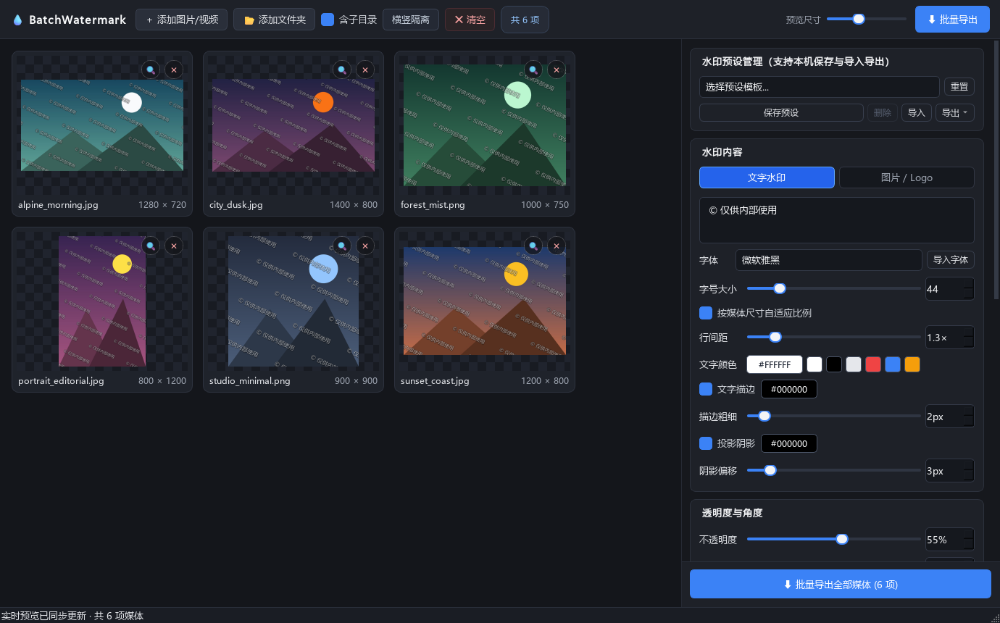
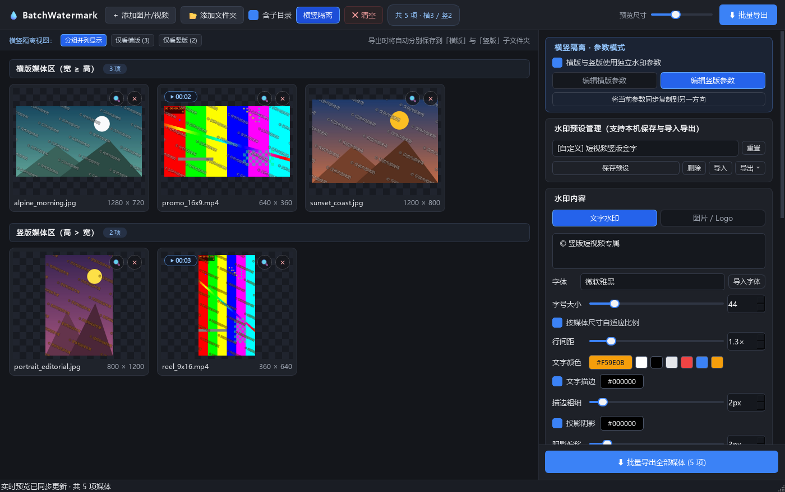

<div align="center">

# BatchWatermark

**现代桌面端批量图片与视频水印工具 — 实时多图同步预览 · 横竖版隔离 · 预设管理 · 所见即所得**

[](https://www.python.org/)
[](https://docs.astral.sh/uv/)
[-41CD52?logo=qt&logoColor=white)](https://doc.qt.io/qtforpython-6/)
[](https://python-pillow.org/)
[](https://ffmpeg.org/)
[](LICENSE)
[](https://github.com/drank5090/BatchWatermark/releases)

</div>

---

## 项目简介

**BatchWatermark** 是一款基于 **Python + PySide6 + Pillow + FFmpeg** 构建的开源桌面应用，专注于高效、所见即所得（WYSIWYG）地为大批量**图片和视频**添加文字或 Logo 水印。

导入多张图片、视频或整个文件夹后，软件会在左侧网格画廊中同时展示所有媒体；当你在右侧操作面板调整任意水印参数（文字、字号、字体、颜色、描边、阴影、透明度、角度、排布间距、九宫格位置、Logo 缩放等）时，**预览区域内的全部图片与视频帧会同步实时变化**，并支持一键全分辨率批量导出。

---

## 界面预览

### 1. 多图实时同步预览（斜向平铺水印）


### 2. 横竖隔离模式 + 独立水印参数 + 视频实时预览 + 自定义预设


---

## 核心功能

### 1. 多图 / 视频 / 文件夹批量导入与实时同步预览
- **灵活导入**：支持多选文件、导入整个文件夹（可选是否递归子目录）、直接拖拽文件或文件夹到预览区，自动按路径去重。
- **格式广泛**：
  - **图片**：`JPG` / `JPEG` / `PNG` / `WebP` / `BMP` / `TIFF`，自动按 EXIF Orientation 矫正竖拍照片。
  - **视频**：`MP4` / `MOV` / `MKV` / `AVI` / `WebM` / `M4V` / `WMV` / `FLV`，自动提取真实展示方向代表帧并标注 `▶ 时长` 徽章。
- **流畅的多线程实时渲染**：
  - 采用 **40ms 防抖 + 分代渲染令牌 + 多线程池 + 视口优先调度**，优先刷新屏幕当前可见卡片，拖动滑块丝滑不卡顿。
  - 支持自由调节预览卡片尺寸、单张移除、一键清空。
- **高清大图与视频时间轴预览**：双击任意卡片或点击 `🔍` 可打开高清预览弹窗；视频支持拖动时间轴滑块或快捷跳转（`开头` / `25%` / `50%` / `75%`）检查任意时刻帧的水印效果。

### 2. 横版 / 竖版隔离模式（`横竖隔离`）
- **分开展示**：一键开启后，预览区自动拆分为 **「横版媒体区（宽 ≥ 高）」** 与 **「竖版媒体区（高 > 宽）」**，顶部提供 `分组并列显示` / `仅看横版` / `仅看竖版` 快捷筛选，计数角标实时显示 `横 N / 竖 M`。
- **可选独立水印参数**：
  - 默认横竖共用同一套参数（零学习成本）。
  - 勾选 **「横版与竖版使用独立水印参数」** 后，可分别切换编辑横版与竖版的水印样式（例如 16:9 横屏视频与 9:16 竖屏短视频分别定制字号、文字或位置），并支持一键同步复制到另一方向。
- **分文件夹隔离导出**：导出时自动在输出目录下创建 **`横版/`** 与 **`竖版/`** 子文件夹分类存放，图片与视频均适用。

### 3. 自定义预设管理（本机持久化 + JSON 导入导出）
- **内置模板**：开箱提供「全图斜向平铺 (防盗)」「右下角精致签名」「正中心醒目样图」「底部居中版权栏」4 套实用模板。
- **本机持久保存**：点击 **「保存预设」** 即可将当前水印参数持久化至本机配置目录，重启软件后自动加载；支持覆盖更新与删除。
  - Windows：`%APPDATA%\BatchWatermark\custom_presets.json`
  - macOS：`~/Library/Application Support/BatchWatermark/custom_presets.json`
  - Linux：`~/.config/BatchWatermark/custom_presets.json`
- **便携 JSON 导入导出**：
  - 点击 **「导出」** 可选择「导出当前水印参数 (.json)」或「导出全部本机自定义预设 (.json)」，方便团队共享或跨设备迁移。
  - 点击 **「导入」** 可读取单个或批量预设 JSON 文件（重名自动编号避免覆盖），导入后自动写入本机并即时应用到预览。

### 4. 丰富的水印样式与严格 WYSIWYG 算法
- **文字水印**：支持多行换行、自动扫描系统中文/英文字体（微软雅黑、黑体、宋体、楷体、仿宋、等线、Segoe UI、Arial 等）及导入本地 `.ttf / .otf / .ttc` 字体；支持颜色拾取与常用色板、文字描边、投影阴影、行间距调节。
- **图片 / Logo 水印**：支持带 Alpha 透明通道的 PNG / WebP Logo，按目标媒体宽度百分比自适应缩放。
- **两种排布模式**：
  - **全图平铺**：支持自定义水平/垂直间距、任意旋转角度、奇偶行砖墙交错排布（基于旋转基向量定位，无四角裁切伪影）。
  - **单点定位**：直观的 3×3 九宫格定位器 + 水平/垂直边距百分比 + X/Y 精细微调。
- **所见即所得**：默认开启「按媒体尺寸自适应比例」，不同分辨率的图片和视频混合批处理时保持统一视觉大小；预览渲染与全分辨率导出共享同一套渲染引擎与比例换算。

### 5. 高保真批量导出（图片 + 视频）
- 支持自定义输出目录、文件名前缀/后缀（默认后缀 `_watermarked` 保护原图）、重名自动编号或覆盖。
- **图片导出**：支持保持原格式 / JPEG / PNG / WebP，可调节压缩质量（50%–100%）与保留原图 EXIF（同时将 Orientation 规范化为 `1`，避免二次旋转）。
- **视频导出**：将 Pillow 生成的全分辨率透明水印 PNG 图层通过 FFmpeg 单次 `overlay` 滤镜合成至视频每一帧，输出高兼容性 H.264 `MP4`（`yuv420p` + `faststart`），默认保留原声（AAC 192k，可勾选静音），支持实时百分比进度条与随时取消。

---

## 快速开始（基于 uv）

本项目采用 [uv](https://docs.astral.sh/uv/) 进行依赖与虚拟环境管理，要求 **Python 3.10+**。

### 1. 安装 uv（如尚未安装）

```powershell
# Windows (PowerShell)
powershell -ExecutionPolicy ByPass -c "irm https://astral.sh/uv/install.ps1 | iex"
```

```bash
# macOS / Linux
curl -LsSf https://astral.sh/uv/install.sh | sh
```

### 2. 克隆仓库并安装依赖

```bash
git clone https://github.com/drank5090/BatchWatermark.git
cd BatchWatermark
uv sync
```

### 3. 启动软件

```bash
# 方式一：通过已注册的命令启动
uv run batch-watermark

# 方式二：直接运行入口脚本
uv run python main.py

# 方式三：启动时直接加载指定图片、视频或文件夹
uv run batch-watermark "D:/Media/PhotosAndVideos"
```

---

## 开发、测试与打包 EXE

安装包含测试工具（`pytest`）与打包工具（`pyinstaller`）的完整开发依赖：

```bash
uv sync --all-groups
```

### 运行自动化测试

```bash
uv run pytest -v
```

测试套件涵盖：
- `tests/test_engine.py`：中英文多行文字、描边阴影、九宫格定位、旋转交错平铺、Logo 水印、预览/原图 WYSIWYG 比例一致性、EXIF 方向规范化、多格式导出与冲突策略。
- `tests/test_presets_and_video.py`：自定义预设本机落盘与重载、单/批量 JSON 导入导出与重名处理、横竖隔离分目录导出、真实 FFmpeg MP4 视频帧提取、水印烧录及音轨保留。
- `tests/test_ui_integration.py`：PySide6 离屏集成测试（多图与视频同步实时刷新、横竖隔离切换、独立参数、自定义预设持久化与批量导出闭环）。

### 打包为 Windows 独立单文件 EXE

项目内置 [BatchWatermark.spec](BatchWatermark.spec)，会自动剔除无关重型库并打包内置 `ffmpeg.exe` 与应用图标：

```bash
uv run pyinstaller BatchWatermark.spec --clean -y
```

打包完成后，独立可执行文件位于 `dist/BatchWatermark.exe`（无需目标电脑安装 Python 或 FFmpeg，双击即用）。

### GitHub Actions 自动打包与发布（仅 Tag 触发）

项目已配置 [.github/workflows/release.yml](.github/workflows/release.yml)，**仅在推送 Git Tag 时触发**（普通分支提交与 PR 不会触发）：

1. 在 `windows-latest` 上使用 `uv sync --locked --all-groups` 还原锁定依赖并执行 `pytest` 自动化测试；
2. 调用 PyInstaller 自动打包独立单文件 `BatchWatermark-<tag>-win64.exe` 并进行启动冒烟验证；
3. 生成 `SHA256SUMS.txt` 校验文件，自动创建 GitHub Release 并上传附件（包含 `-alpha` / `-beta` / `-rc` 的 Tag 自动标记为 Pre-release）。

发布新版本只需推送 Tag：

```bash
git tag v1.0.0
git push origin v1.0.0
```

---

## 预设 JSON 文件格式说明

导出的预设文件采用 UTF-8 JSON 格式，支持单预设与多预设集合，也可手动编辑后导入：

```json
{
  "schema": "batch_watermark_presets",
  "version": 1,
  "presets": {
    "短视频竖版金字": {
      "watermark_type": "text",
      "text": "© 竖版短视频专属",
      "font_name": "微软雅黑",
      "custom_font_path": "",
      "font_size": 44,
      "proportional_size": true,
      "text_color": "#F59E0B",
      "line_spacing": 1.25,
      "stroke_enabled": true,
      "stroke_width": 2,
      "stroke_color": "#000000",
      "shadow_enabled": true,
      "shadow_offset": 3,
      "shadow_color": "#000000",
      "logo_path": "",
      "logo_scale_percent": 22,
      "opacity": 65,
      "rotation": -25,
      "layout_mode": "tiled",
      "anchor": "bottom_right",
      "margin_x_percent": 4.0,
      "margin_y_percent": 4.0,
      "offset_x_percent": 0.0,
      "offset_y_percent": 0.0,
      "tile_spacing_x": 120,
      "tile_spacing_y": 100,
      "tile_stagger": true
    }
  }
}
```

> 提示：导入功能同时兼容直接包含字段的扁平单预设 JSON 对象（此时自动以文件名作为预设名）。

---

## 项目结构

```text
BatchWatermark/
├── assets/
│   └── app_icon.ico               # 多尺寸 Windows 应用图标
├── batch_watermark/
│   ├── __init__.py                # 版本信息
│   ├── app.py                     # 应用引导入口与资源路径解析
│   ├── models.py                  # 数据模型（WatermarkConfig / ExportConfig / ImageItem 等）
│   ├── fonts.py                   # 跨平台系统字体发现与 LRU 缓存
│   ├── presets.py                 # 内置模板、本机持久化 PresetStore 与 JSON 导入导出
│   ├── engine.py                  # Pillow 水印图层渲染引擎（图片/视频共用）与图片导出
│   ├── video_engine.py            # FFmpeg 视频帧提取、方向解析与 MP4 合成导出
│   ├── workers.py                 # Qt 异步媒体加载、分代预览渲染池与批量导出线程
│   └── ui/
│       ├── theme.py               # Studio Dark 全局 QSS 样式表
│       ├── widgets.py             # 同步滑块、取色器、3×3 九宫格定位等通用控件
│       ├── preview_gallery.py     # 多图/视频预览画廊、横竖分区、拖拽导入与高清预览窗
│       ├── control_panel.py       # 参数面板、横竖独立参数切换、预设管理与导出配置
│       └── main_window.py         # 主窗口、工具栏、防抖调度与导出进度弹窗
├── docs/
│   └── images/                    # README 展示截图
├── tests/
│   ├── test_engine.py             # 图像处理与 WYSIWYG 单元测试
│   ├── test_presets_and_video.py  # 预设持久化、横竖隔离与视频水印测试
│   └── test_ui_integration.py     # PySide6 界面集成测试
├── BatchWatermark.spec            # PyInstaller 独立单文件打包配置
├── main.py                        # 脚本直接启动入口
├── pyproject.toml                 # uv / PEP 621 项目元数据与依赖配置
├── uv.lock                        # uv 确定性依赖锁文件
├── LICENSE                        # MIT 开源协议
└── README.md
```

---

## 常见问题（FAQ）

<details>
<summary><strong>1. 为什么视频导出支持手机竖拍视频而不会倒转？</strong></summary>

软件在解析与预览视频时通过 FFmpeg 解码真实展示方向帧（自动应用 MP4 DisplayMatrix 旋转元数据），并以旋转后的实际宽高进行横竖分类与水印合成，避免横竖误判或导出后画面倒转。
</details>

<details>
<summary><strong>2. 导出图片时为什么默认带 <code>_watermarked</code> 后缀？</strong></summary>

为防止用户将输出目录设为原图所在文件夹时意外覆盖原始素材，默认自动添加 `_watermarked` 后缀且冲突策略设为「重名自动编号」。如需保持原名，可在右侧导出设置中清空后缀。
</details>

<details>
<summary><strong>3. 需要自己额外安装 FFmpeg 吗？</strong></summary>

不需要。源码运行通过 `imageio-ffmpeg` 自动提供独立 FFmpeg 二进制；打包后的 `BatchWatermark.exe` 也已内嵌 `ffmpeg.exe`，同时优先兼容系统 `PATH` 中的 FFmpeg。
</details>

---

## 开源协议

本项目基于 [MIT License](LICENSE) 开源，欢迎自由使用、反馈 Issue 与提交 Pull Request。
